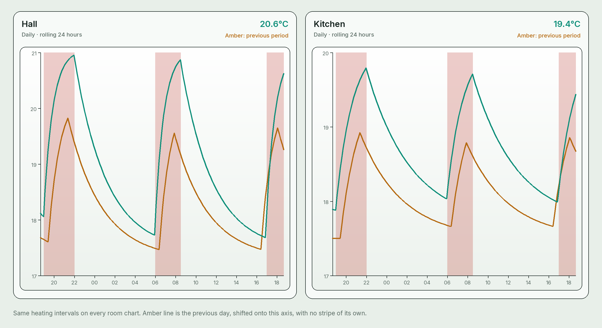
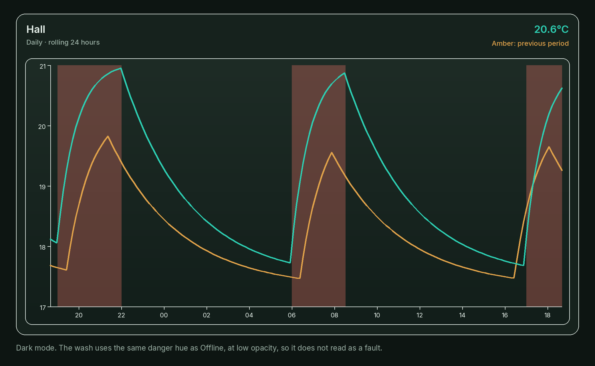
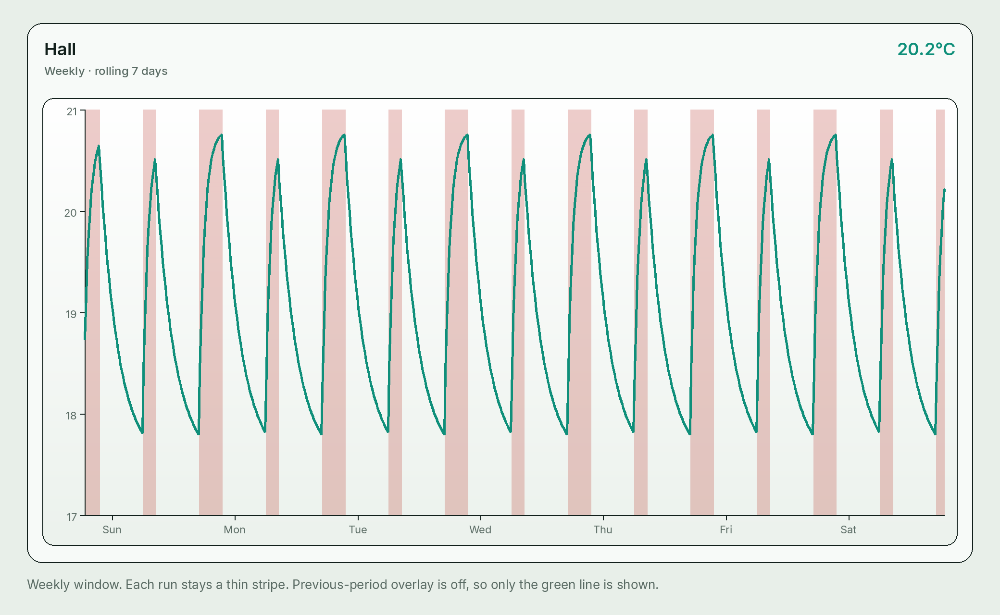
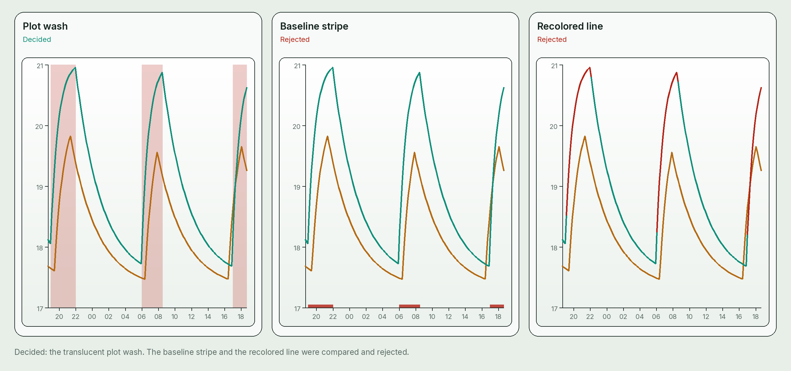
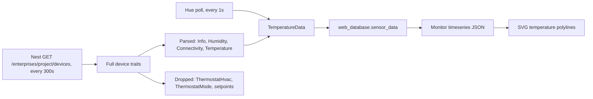
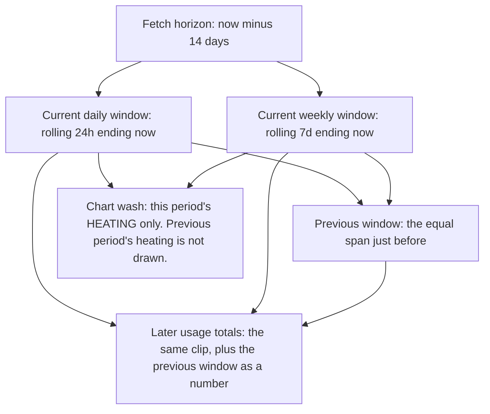
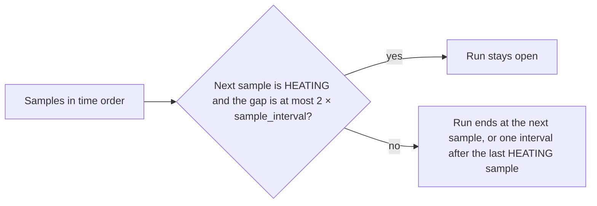
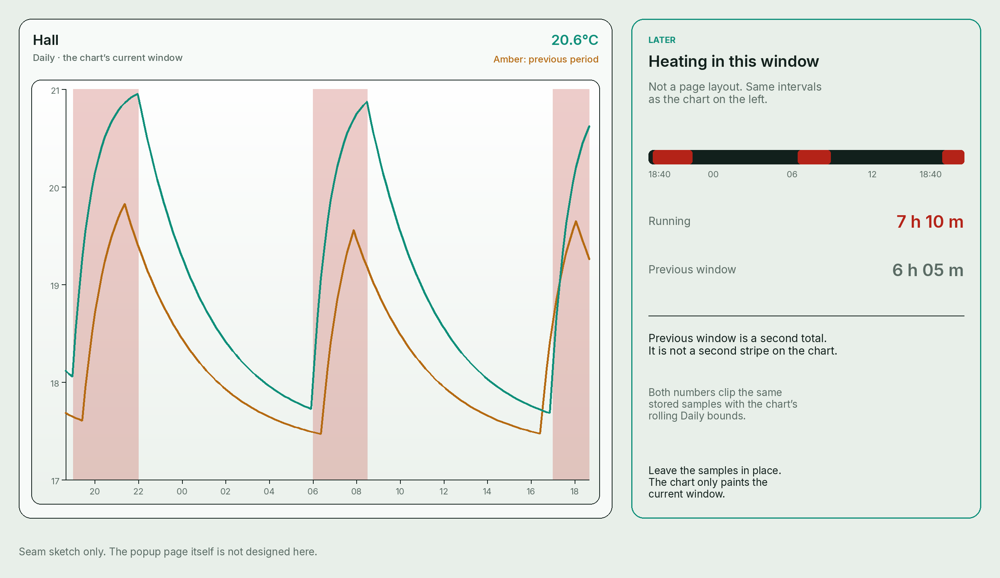
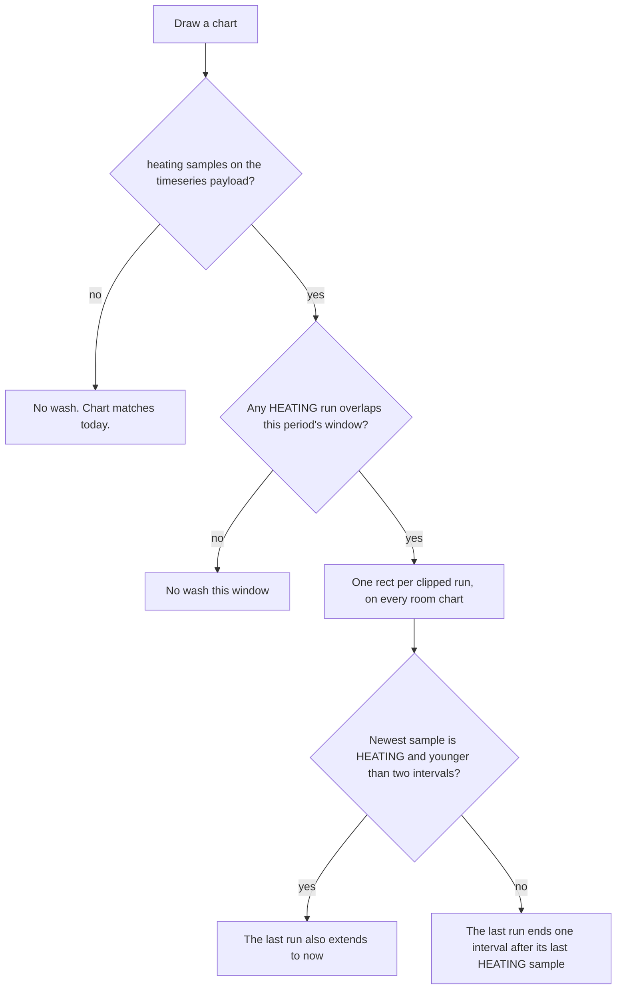

# Heating running on the Monitor charts

## Goal

Show, on the Monitor temperature charts, the times when the heating is actually running. Use a subtle red stripe. Keep the temperature line, the previous-period line, and the Daily / Weekly windows as they are.

A later page can show heating usage for a window (how long it ran). This note does not design that page. It keeps a shared time range and a shared sample series so the page can sum the same intervals the chart paints.

Figures live in `Design/images/` and are linked with relative paths. `Design/` is where backend design notes already live (`nest-thermostat-integration.md`). That note has no figures; this is the pattern for notes that need them.

The charts below are mockups in the Monitor colors. Hall and Kitchen are stand-in room names. The curves are not live readings.

## Recommendation

Paint a translucent red wash across the plot for each interval where the Nest HVAC status is `HEATING`. That status is “actually running” for this house. Draw the wash behind both temperature lines, on every room chart, for the current Daily or Weekly window only. There is one thermostat, so every chart shares that one timeline. When “Previous period” is on, the wash stays, and it is still only this period’s heating.







This is the decided stripe. Each Monitor chart is one SVG. The plot already has a shared horizontal scale (time) and a vertical scale (degrees). A rectangle from the top of the plot to the baseline, in that x range, sits in the same coordinate system as the polyline. The line stays the usual green, so a room reading and a heating interval stay different marks. The amber previous-period line stays amber and does not grow a stripe of its own.

Use the existing danger hue, at plot opacity rather than the pill opacity:

| Theme | Token | Value |
| --- | --- | --- |
| Light | `--heating-band` | `rgba(180, 35, 24, 0.23)` |
| Dark | `--heating-band` | `rgba(255, 122, 110, 0.31)` |

Light danger is `#b42318` and dark danger is `#ff7a6e` in `website3` `website/static/css/tools/webapp-tokens.css`. `--danger-soft` is only 10% / 12% and is meant for the Offline pill. At that opacity the wash disappears on the chart. The mockups use the values in the table.

The wash is a view of stored samples. It does not change the temperature points, and it is not the record the usage page should sum. See [What the chart leaves in place](#what-the-chart-leaves-in-place).

## Options compared

The wash is the treatment. The other two were compared and rejected. The baseline stripe is not a fallback.



| Treatment | What it does | Decision |
| --- | --- | --- |
| Plot wash | One translucent rect per run, full height of the plot, behind the lines | Use this. Same x scale as `drawTemperatureLine`. The green line and the amber overlay stay themselves. A run’s width is its duration, on both Daily and Weekly. |
| Baseline stripe | A few pixels of solid red along the bottom of the plot | Rejected. On this SVG the axis ticks hang 5px below the baseline and the night-time line often sits on that baseline, so the stripe collides with the line and is easy to miss on a week view. |
| Recolored line | The temperature polyline turns red while heating is on | Rejected. It throws away the live-green reading. Smoothing makes it worse: the Smoothed control averages temperature over 45 minutes (Daily) or 3 hours (Weekly), so a red segment would no longer match a single on/off sample. The line is also per room sensor; heating is not. |

Edge ticks at start and stop were set aside. They do not show duration, so the chart would no longer display the interval a usage total sums.

## What the code does today

rust-backend polls sensors and writes MongoDB. The Monitor UI in website3 reads that database and draws the charts in the browser. Neither side stores heating.



### rust-backend

`backend/src/main.rs` opens `web_database.sensor_data` and a unique index on `{ device_name: 1, timestamp: -1 }`. Hue and Nest each get a `MongoClient` for that same collection.

Hue (`backend/src/sensor_control/sensors.rs`) polls every 1 second. Each row uses the bridge `temperature_report.changed` time and writes `humidity: 0.0`.

Nest (`backend/src/sensor_control/nest.rs`) polls every 300 seconds (`POLL_INTERVAL_SECS`). `get_temperatures` keeps devices whose `type` is `sdm.devices.types.THERMOSTAT`, then builds `TemperatureData` with `timestamp: Utc::now()`. The traits it reads are only those on `NestTraits` in `backend/src/sensor_control/models.rs`:

- `sdm.devices.traits.Info`
- `sdm.devices.traits.Humidity`
- `sdm.devices.traits.Connectivity`
- `sdm.devices.traits.Temperature`

`NestTraits` does not use `deny_unknown_fields`, so a HVAC or mode trait in the JSON is ignored. `TemperatureData` is `device_name`, `timestamp`, `online`, `temperature`, `humidity`.

`store_temperatures` (`backend/src/sensor_control/store.rs`) inserts a row only when its timestamp is strictly newer than the latest stored row for that `device_name`. Nest’s timestamp is the poll time, so each successful Nest poll inserts a row even when the temperature is unchanged. Hue can stay quiet while the bridge timestamp does not move.

`Design/nest-thermostat-integration.md` left mode and setpoint control out of scope, and left the `sensor_data` document shape alone. This note does not reopen control, and it does not add fields to `sensor_data`.

### Monitor

website3 `website/tools/monitor/__init__.py` reads `web_database.sensor_data`.

`SensorData` (`website/tools/monitor/models.py`) is the same five fields. `TimeseriesDataPoint` is `timestamp`, `temp`, `humidity`.

`GET /tools/monitor/timeseries` (`website/tools/monitor/router.py`) loads the last 14 days per `device_name` (`datetime.now() - timedelta(days=14)`), skipping `Office Thermometer` and `Bedroom Thermometer`. The comment on that query says the 14 days exist so Daily and Weekly charts can draw the previous period. `latest_data` returns one latest row per device. The status pill is that row’s `online` field: “Online” or “Offline”. Hue writes `online: true` on every row. Nest writes `Connectivity.status == ONLINE`. Neither value is HVAC status.

The page script (`website/static/js/tools/monitor/monitor.js`) requests `/timeseries/` and `/latest_data/` every 5 seconds and sets `deviceData = response_data.data`. The FastAPI handlers are mounted at `/tools/monitor/timeseries` and `/tools/monitor/latest_data` (`tools` prefix plus `monitor` prefix). The Monitor host in website3 is `monitor.schleising.net`. This checkout has no rewrite between those paths. Put heating on the `timeseries()` payload either way; confirm the host mapping when wiring the page.

There is one SVG per device (`chart-{device_id}` in `website/templates/tools/monitor/monitor.html`). Humidity is a number beside the chart, not a line. `device_id` is `device_name.lower().replace(" ", "-")`.

### How a chart is drawn

`getPeriodBounds(period, periodOffset)` builds a rolling window ending at now. Daily is 24 hours. Weekly is 7 days. Offset `1` is the equal window immediately before that. The windows are not calendar days and not midnight-aligned.

`getChartSeries` then:

1. Filters points with `timestamp >= start && timestamp < end`.
2. If “Previous period” is on, shifts the previous window forward by one day or one week (`alignPreviousPeriodData`) so it shares the current x axis.
3. If “Smoothed” is on, replaces `temp` with a centered moving average. Daily window is 45 minutes. Weekly window is 3 hours. Timestamps are unchanged.

`setTransformationMatrix` maps that x range and the data’s degree range into the SVG, with 30px horizontal padding and 40px vertical padding. Y limits are `floor(min)` and `ceil(max)` of the current line and the overlay line together.

`drawChart` clears the SVG, draws the axes (`drawGrid`), then the lines (`drawTemperature`). The overlay line is class `temperature-overlay` (amber `#b56a12` / dark `#e0a24a`). The current line is class `temperature temperature-current` (green `--live`, `#0f8f7a` / dark `#2dceb2`). `updateChart` removes and rebuilds the grid, then replaces each polyline by id. Scrubbing uses the polyline points only.

Any heating mark has to be rebuilt in both `drawChart` and `updateChart`, after the grid and before the lines, or a later grid append covers it and a second update duplicates it.

## Called for versus actually running

The code does not distinguish these. It records neither.

The Nest device-type page linked from the existing Nest note documents two different traits. Both can appear on the GET the poller already makes. Only the second one means the equipment is on.

| Meaning | Trait and values | In this repo today | On the chart |
| --- | --- | --- | --- |
| Heat mode selected (“called for” as a mode) | `sdm.devices.traits.ThermostatMode.mode`: `HEAT`, `COOL`, `HEATCOOL`, `OFF` | Not parsed | Stored as `mode`. Not drawn. |
| HVAC actually running | `sdm.devices.traits.ThermostatHvac.status`: `OFF`, `HEATING`, `COOLING` | Not parsed | The wash is `HEATING` only. |
| Requested temperature | `sdm.devices.traits.ThermostatTemperatureSetpoint` (`heatCelsius`, `coolCelsius`) | Not parsed | Stored when the GET includes the field. Not drawn. |

Google’s HVAC trait notes that a mode change and the HVAC status change are separate events. The thermostat can delay the start to protect the equipment: `ThermostatMode` and `ThermostatTemperatureSetpoint` events arrive first, and `ThermostatHvac` follows when the system actually turns on. That note is about events. This poller does not subscribe to events, but a GET during the delay can still show `mode: HEAT` while `status` is `OFF`. Sources: [ThermostatHvac](https://developers.google.com/nest/device-access/traits/device/thermostat-hvac), [ThermostatMode](https://developers.google.com/nest/device-access/traits/device/thermostat-mode), [ThermostatTemperatureSetpoint](https://developers.google.com/nest/device-access/traits/device/thermostat-temperature-setpoint). A GET of the setpoint trait returns only the active mode’s `heatCelsius` and/or `coolCelsius`.

`HEAT` can stay selected all winter while status is `OFF` most of the time. A stripe on mode would paint the chart red for the season. `HEATCOOL` does not say whether the equipment is heating or cooling. Setpoint versus ambient is a third signal. The delay above is why it is the wrong proxy for “running”. Store the setpoint anyway, for the later usage page, and keep it off the chart.

`COOLING` must not use the red wash. Keep the sample so a later change could show cooling. Do not draw it in this design.

“Actually running” is `ThermostatHvac.status == HEATING`. The Nest GET already returns that trait, and the poller currently drops it. This house does not wait for a boiler-flame, heat-link, or OpenTherm sensor. None of those are in either repo, and none are required for the wash.

## What to record

Add a collection, `web_database.heating_samples`. Leave `sensor_data` and `TemperatureData` as they are.

A sample:

```json
{
  "device_name": "Living Room Nest",
  "timestamp": { "$date": "2026-10-24T17:00:00.000Z" },
  "hvac_status": "HEATING",
  "mode": "HEAT",
  "heat_celsius": 20.0
}
```

| Field | Source |
| --- | --- |
| `device_name` | Same `display_name()` as the Nest temperature row. This house has one thermostat. |
| `timestamp` | Same `Utc::now()` as that poll’s Nest `TemperatureData` |
| `hvac_status` | `ThermostatHvac.status` (`OFF`, `HEATING`, `COOLING`) |
| `mode` | `ThermostatMode.mode`, omitted when the trait is absent. Stored now. Not drawn. |
| `heat_celsius` | `ThermostatTemperatureSetpoint.heatCelsius`, omitted when the GET does not include it. Stored now. Not drawn. |
| `cool_celsius` | `ThermostatTemperatureSetpoint.coolCelsius`, omitted when the GET does not include it. Stored now. Not drawn. |

A GET of the setpoint trait returns only the active mode’s targets: `heatCelsius` in `HEAT`, `coolCelsius` in `COOL`, and both in `HEATCOOL`. Omit a field the response did not include. Do not copy the other mode’s target forward from an older sample.

Write one sample per successful poll, including when status did not change. The 300-second heartbeat is what makes a gap mean “the poller missed”, rather than “status was steady”. Skip the poll when `ThermostatHvac` is absent. Do not invent `OFF`. Samples about every 300 seconds are enough: a usual heating run is about 20 minutes, so a run spans several polls.

Unique index: `{ device_name: 1, timestamp: -1 }`, matching `sensor_data`.

`mode` and the setpoint fields are for the later usage page. They let that page compare time in `HEAT`, the requested temperature, and time in `HEATING` without another migration. They are not a definition of running. The wash still keys off `hvac_status == HEATING` only.

Why a new collection, rather than an optional field on the Nest temperature row:

- Heating is one system. Hue rows and the other rooms do not have it. The charts that need the stripe are those room charts.
- `TemperatureData` is shared by Hue and Nest. `get_latest_items` deserializes latest rows back into that struct.
- The website model would otherwise have to guess which `device_id` is the thermostat. `device_id` is only a slug of `device_name`.
- Usage math wants intervals. Scanning `sensor_data` mixes Nest’s 5-minute rows with Hue’s much finer rows.
- The Nest v1 note promised not to change the `sensor_data` shape. A sibling collection keeps that promise.

Keep `POLL_INTERVAL_SECS` at 300. A usual run of about 20 minutes is several samples, which is enough for the wash and for a later duration total. A run that starts and ends inside one 300-second gap still never appears, and transitions land on poll times, plus the HVAC delay Nest already documents. That limit is accepted. Do not infer the missing minutes from mode, from setpoint, or from the temperature slope. Do not speed the Nest poll for this feature.

### Payload the chart already polls

Extend `TimeseriesDataResponse` with a sibling of `data`. Old page script ignores unknown keys. Missing `heating` means “draw today’s chart”.

```json
{
  "data": [
    {
      "device_id": "hall",
      "data": [{ "timestamp": "2026-10-24T17:05:00+00:00", "temp": 19.4, "humidity": 48.0 }]
    }
  ],
  "heating": {
    "sample_interval_secs": 300,
    "device_name": "Living Room Nest",
    "device_id": "living-room-nest",
    "samples": [
      {
        "timestamp": "2026-10-24T17:00:00+00:00",
        "hvac_status": "HEATING",
        "mode": "HEAT",
        "heat_celsius": 20.0
      }
    ]
  }
}
```

There is one thermostat, so `heating` is one series, not a list of sources to choose from. `device_id` uses the same `lower().replace(" ", "-")` expression as `SensorDataMessage`. The poller already loops every device of type `THERMOSTAT`; in this house that loop has one entry, and that entry is the timeline on every room chart. Query `heating_samples` with the same `since` expression the timeseries handler already uses (`now` minus 14 days), so both series cover the previous week. That `datetime.now()` is naive; stored timestamps are UTC. Copy the existing expression. Do not invent a second clock in this change.

`sample_interval_secs` is the poll interval the writer used. The browser needs it for the gap rule below, and should not hardcode 300.

## Time range



The chart’s window function is `getPeriodBounds`. Daily and Weekly stay rolling windows ending at now. The usage follow-on should call that same function, not midnight-to-midnight days and not a range clipped from the SVG.

### Turning samples into runs

One rule, used by the wash and by any later total. Name it beside `getPeriodBounds` (today that function is private in `monitor.js`; the follow-on should share it rather than re-derive runs from pixels).



1. Sort by timestamp.
2. `OFF` and `COOLING` break a run. Only `HEATING` extends one.
3. A gap longer than `2 × sample_interval_secs` also breaks a run. End that run at `last HEATING sample + sample_interval`. An outage must not count as heating.
4. If the newest sample is `HEATING` and `now − newest ≤ 2 × sample_interval`, the open run ends at now (the right edge of the chart). If the newest sample is older than that, do not extend it. A stopped poller must not look like the boiler is still on.
5. Clip to the window: `start` inclusive, `end` exclusive, matching `filterDataForPeriod`.

Do not run heating samples through `smoothTemperatureSeries` or `alignPreviousPeriodData`. Smoothing would average a boolean. The overlay shift would paint yesterday’s runs on today’s clock.

Previous-period heating stays in the payload (the 14-day fetch already holds it) and is not drawn. That is decided: when “Previous period” is on, keep the wash visible, and draw only this period’s heating. The amber line is the previous window’s temperature moved onto today’s axis. The wash belongs to the axis of the current window. A wash at 07:00 means heating was running at 07:00 in this window. The amber point at that x is the previous window’s temperature. Yesterday’s heating is a total on the later page, not a second wash.

## How to draw it

In both `drawChart` and `updateChart`, after `drawGrid` and before `drawTemperature`:

1. Remove `#heating-bands-{device_id}` if it exists.
2. If `heating` is missing or has no samples, draw nothing. Otherwise paint that one series on every room chart. Runs come from `hvac_status == HEATING` only. Ignore `mode`, `heat_celsius`, and `cool_celsius` while drawing.
3. Build runs with the rule above, clipped to `getPeriodBounds(chartPeriod, 0)`. Do not clip to period offset 1, and do not shift those runs with `alignPreviousPeriodData`.
4. Append a `<g class="heating-bands" id="heating-bands-{device_id}">` with one `<rect class="heating-band">` per run. Map x through the same matrix as the polyline. Y spans the plot from `minTemp` to `maxTemp` (the axis corners `drawGrid` already computes). Clip to that rectangle so the wash does not cover the degree labels.
5. `pointer-events: none`. A `<title>Heating running</title>` on the group is the accessible name. Scrubbing keeps using polyline points, so the wash does not move the readout.

CSS, in `monitor.css`:

```css
.chart-svg .heating-band {
  fill: var(--heating-band);
  stroke: none;
}
```

Set `--heating-band` on `:root` and `body.dark-mode` to the table in the recommendation.

Leave the toolbar alone. Temperature is not optional; the wash should not be a third checkbox next to “Previous period” and “Smoothed”. “Smoothed” does not move the wash. A smoothed line can rise before a band or lag it, because the average is 45 minutes or 3 hours wide. That is the existing average, not a heating bug.

Do not write “Heating” into `#status-{device_id}`. That node is `online`.

Until `heating_samples` has rows, `heating` is missing or empty and the SVG matches today’s chart. Do not backfill. Do not draw a band for “unknown”.

## What the chart leaves in place



The right-hand panel is a sketch of the seam, not a popup layout. The “6 h 05 m” previous-window figure is illustrative. The “7 h 10 m” figure is the sum of the three runs drawn on the left of that mockup (19:00–22:00, 06:00–08:30, 17:00–18:40 on a window ending 18:40).

The chart should leave these untouched so a usage page can follow:

| Leave this | Why the page needs it |
| --- | --- |
| `heating_samples` as heartbeats, not as the only stored form of a run | A change to the gap rule recomputes history. Edge rows alone hide a crash between on and off. |
| `hvac_status`, `mode`, `heat_celsius`, and `cool_celsius` on each sample | The page can later show running time, time in heat mode, and the requested temperature from the same rows. The chart paints `HEATING` only. |
| The 14-day series on the timeseries payload, unclipped | The previous window is already loaded for the amber line. The page sums it. The chart does not have to draw it. |
| `getPeriodBounds` and the run rule above | Daily, Weekly, and “previous” stay one definition. The page must not invent calendar days. |
| Temperature points with no heating field copied onto them | Smoothing and the overlay shift stay temperature-only. |
| `COOLING` samples, undrawn | A later cooling mark can reuse the collection. |

The page’s first totals are: duration of `HEATING` runs in the current window, and the same sum for the previous window. Same `sample_interval_secs`, same gap rule. A range wider than 14 days is a new query against `heating_samples` when that page is built. The chart’s 14-day payload is the shared read for the horizons the charts already have.

The wash does not have to stay on screen for the page to work. The collection is the store. The page should query that store (or the same `heating` object), not measure the rectangles.

## UI states



“Previous period” and “Smoothed” do not change this diagram. Previous period draws the amber temperature line and leaves the wash on this period’s runs. Smoothed changes the temperature line only. Mode and setpoint never enter the diagram.

## Where a later change lands

This note does not change application code.

| Repo | Later edit |
| --- | --- |
| rust-backend `models.rs` | Deserialize `ThermostatHvac`, `ThermostatMode`, and `ThermostatTemperatureSetpoint`. Add the sample struct. |
| rust-backend `nest.rs` | On a successful poll, insert `heating_samples`. Keep writing `TemperatureData` as today. |
| rust-backend `main.rs` | Create the `heating_samples` collection and its unique index. |
| website3 `monitor/models.py` | Optional `heating` on `TimeseriesDataResponse`. |
| website3 `monitor/router.py` | Load samples with the existing 14-day `since`. |
| website3 `monitor.js` | `heatingRuns` plus the band group in `drawChart` / `updateChart`. |
| website3 `monitor.css` | `--heating-band` and `.heating-band`. |

The service worker already treats `/timeseries/` as live data and fetches it from the network. A new JSON field rides that response. The page script has to be updated before any wash appears.

## Out of scope

- The usage popup’s route, layout, navigation, and any chart of its own.
- Thermostat commands (`SetMode`, setpoint edits). Recording `mode` and the setpoint fields is not control.
- Eco and Pub/Sub. The poll stays a GET on the existing 300-second loop.
- A blue cooling wash, a baseline stripe, and recoloring the temperature line.
- Drawing the previous period’s heating, or hiding the wash while “Previous period” is on.
- A boiler-flame or heat-link sensor.
- Backfill before the first stored sample.
- Changing Hue polling, `sensor_data`, or the Online / Offline pill.

## Decisions

These are closed.

1. **Actually running** is Nest `ThermostatHvac.status == HEATING`. Do not wait for a boiler-flame sensor.
2. **One thermostat.** Draw that one heating timeline on every room chart.
3. **Samples about every 300 seconds are enough.** A usual heating run is about 20 minutes. Leave `POLL_INTERVAL_SECS` at 300.
4. **Store `mode` now, and store the requested temperature when Nest provides it** (`heatCelsius` and/or `coolCelsius`). Neither is drawn.
5. **When “Previous period” is on, keep the wash visible, and draw only this period’s heating.** Do not draw the previous period’s heating.
6. **Use the translucent plot wash.** Do not use the baseline stripe.
