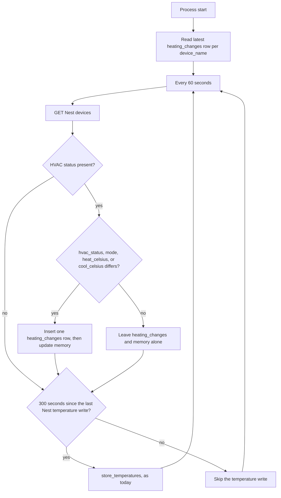
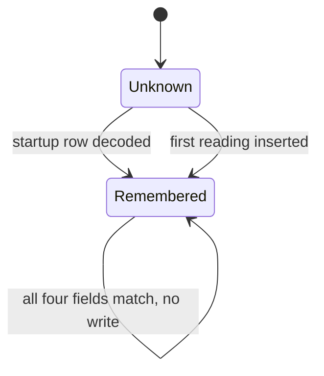

# Heating changes, checked once a minute

## Goal

Check the Nest thermostat once a minute. Write a `web_database.heating_changes` row when any of these changes:

| Field | Meaning |
| --- | --- |
| `hvac_status` | Whether the equipment is actively heating or cooling (`HEATING`, `COOLING`, or `OFF`) |
| `mode` | Whether the equipment will call for heat or cool against its thresholds (`HEAT`, `COOL`, `HEATCOOL`, `OFF`, and the other Nest modes) |
| `heat_celsius` | The heat threshold, in degrees Celsius |
| `cool_celsius` | The cool threshold, in degrees Celsius |

A steady thermostat writes nothing. A change of any one field writes one row carrying all four, timestamped when the poll noticed the change:

```text
12:00  HEATING  HEAT       heat 20.0
12:10  HEATING  HEAT       heat 21.0
12:20  OFF      HEAT       heat 21.0
14:30  COOLING  HEATCOOL   heat 18.0  cool 24.0
14:40  COOLING  HEATCOOL   heat 18.0  cool 23.0
14:45  OFF      HEATCOOL   heat 18.0  cool 23.0
```

The 12:10 row exists because the heat threshold moved. Heating was already running, and it keeps running until 12:20. The 14:40 row exists because the cool threshold moved. Cooling was already running, and it keeps running until 14:45. A `HEAT` row omits `cool_celsius` because Nest did not send it.

Keep Nest temperature rows on their current five-minute cadence, and leave Hue at one second. Do not write `heating_samples`. Remember the last values in the poller. Read `heating_changes` at startup to seed that memory, and write that collection only when any of the four values differs.

`heating_changes` keeps that name. Nothing renames it onto `heating_samples`, and nothing renames `heating_samples` away. Existing `heating_samples` documents stay where they are. The website contract for the new collection is [heating-webapp-interface.md](heating-webapp-interface.md). That file is the copy to take into the website3 design folder.

The code change that follows this note changes which rows exist. Bump `backend/Cargo.toml` from `1.2.1` to `2.0.0` in that change. Stopping writes to the deprecated `heating_samples` collection is a bug fix, `2.0.1` to `2.0.2`. This note does not bump it.

## What the poller did before this change

`NestThermostat::run` in `backend/src/sensor_control/nest.rs` loops one thread. `POLL_INTERVAL_SECS` is 300. Each pass calls `read_thermostat`, which GETs `/enterprises/{project}/devices` and returns both `TemperatureData` and a `HeatingSample`.

`store_temperatures` inserts a Nest temperature row when its timestamp is newer than the latest stored row for that `device_name`. The timestamp is `Utc::now()`, so each successful poll inserts one. Hue is a different thread and stays at one second.

`store_heating_samples` inserts every sample from that same poll, including when nothing changed. A row is `device_name`, `timestamp`, `hvac_status`, and optional `mode`, `heat_celsius`, and `cool_celsius`. The unique index is `{ device_name: 1, timestamp: -1 }`. `HeatingSample::from_thermostat` already omits `mode`, `heat_celsius`, and `cool_celsius` when that GET did not include them, and it returns nothing when `ThermostatHvac` is absent or blank. It does not invent `OFF`. A `HEAT` response carries `heatCelsius`, a `COOL` response carries `coolCelsius`, and `HEATCOOL` carries both.

`get_latest_items` is the only read helper on `Storage`. The heating path does not call it. The temperature path calls it on every store.

## Recommendation

One devices GET a minute. From that response, insert a `heating_changes` row only when `hvac_status`, `mode`, `heat_celsius`, or `cool_celsius` differs from memory. Do not insert into `heating_samples`. Persist Nest temperature only when five minutes have elapsed.



Timestamps are `Utc::now()` at the poll that observed the change. They are not rounded to the clock minute. The loop sleeps 60 seconds after each attempt, the same shape as today’s 300-second sleep, so the check is about once a minute rather than aligned to `:00`.

A missing or blank HVAC status is not an observation. Leave memory unchanged and write nothing for that poll. Do not invent `OFF`, and do not fill `mode`, `heat_celsius`, or `cool_celsius` from the previous row. Nest sends `heatCelsius` in `HEAT`, `coolCelsius` in `COOL`, and both in `HEATCOOL`. A present threshold becoming absent is a real change on the next poll that does include HVAC. `COOLING` stays `COOLING` on the row.

## Memory

The poll thread owns a map from `device_name` to the last values. This house has one thermostat. The map still keys by name so a second thermostat cannot overwrite the first.

```rust
struct RememberedHeating {
    hvac_status: String,
    mode: Option<String>,
    heat_celsius: Option<f32>,
    cool_celsius: Option<f32>,
}
```

Those four fields are stored on `heating_changes`. The poller does not write `heating_samples`.

```json
{
  "device_name": "Living Room Nest",
  "timestamp": { "$date": "2026-10-24T14:40:00.000Z" },
  "hvac_status": "COOLING",
  "mode": "HEATCOOL",
  "heat_celsius": 18.0,
  "cool_celsius": 23.0
}
```

| Field | Rule |
| --- | --- |
| `device_name` | Same `display_name()` as the Nest temperature row |
| `timestamp` | `Utc::now()` when these values were first observed |
| `hvac_status` | Trimmed `ThermostatHvac.status` (`OFF`, `HEATING`, or `COOLING`). Required |
| `mode` | Trimmed `ThermostatMode.mode`. Omitted when absent or blank |
| `heat_celsius` | `ThermostatTemperatureSetpoint.heatCelsius`. Omitted when the GET did not include it |
| `cool_celsius` | `ThermostatTemperatureSetpoint.coolCelsius`. Omitted when the GET did not include it |

Two readings match when `hvac_status` is the same string, `mode` is the same optional string, and both thresholds are the same optional values. Compare the numbers Nest sent. A missing threshold is not `0.0`.

`heating_samples` keeps the documents already stored there. The poller does not open that collection and does not insert into it. `heating_changes` has the unique index `{ device_name: 1, timestamp: -1 }`. `sensor_data` and `TemperatureData` stay as they are.

A successful GET that produces a `HeatingSample` calls `store_heating_samples` only for the rows `select_heating_changes` returns, and only against `heating_changes`.

Seed the change-log map once, in `NestThermostat::run`, before the loop, from `heating_changes`:

1. `get_latest_items("device_name", "timestamp")` on that collection.
2. Insert each returned row into the map, including `cool_celsius` when the row has it.
3. An empty `heating_changes` leaves the map empty. Empty is unknown, not `OFF` and not a zero threshold. The first real observation inserts one change row.

Do not call `get_latest_items` on `heating_changes` again from the loop. Do not seed the map from `heating_samples`. The temperature helper may keep calling `get_latest_items` on `sensor_data` for the five-minute write.



- All four fields match: do not touch the database.
- Any field differs, or the device has no entry: insert one row, then store that reading in the map.
- Update the map only after the insert returns `Ok`. A failed insert leaves the old memory, so the next minute retries that row while the thermostat still shows the new values. A change that appears and disappears inside a failed write is missed; that is the same class of loss as a missed poll.

A seed error is not an empty `heating_changes`. Log it, leave change-log writes disabled for the rest of this process, and keep storing temperatures. Restart after `heating_changes` is readable. Do not read that collection again every minute.

`poll_once` can take `&mut self` so the map does not need its own mutex. The access-token mutex stays as it is.

## Temperature cadence

The devices GET moves from every 300 seconds to every 60 seconds because HVAC, mode, setpoint, and temperature arrive on the same response. The Nest temperature rows stay about every 300 seconds.

Hold `last_nest_temperature_at` in the poll thread. It starts unset and is not read from `sensor_data`.

- On a successful GET, if that instant is unset or at least 300 seconds old, call `store_temperatures` and set it to now.
- Otherwise skip the temperature write.
- A failed GET does not move the instant, so the next success can still land on the five-minute mark.
- The first success after process start writes one Nest temperature row, then waits 300 seconds. That matches today’s first poll.

Hue `sensors.rs` stays at one second. Do not copy heating fields onto `sensor_data`.

## Migration

The one-shot migration has been run. It copied a collapsed change log from `heating_samples` into `heating_changes` and left `heating_samples` in place. The `heating_migrate` binary has been removed.

## Rollout

The poller writes `heating_changes` and does not write `heating_samples`. The Monitor page reads `heating_changes`, as specified in [heating-webapp-interface.md](heating-webapp-interface.md). That reader treats the space between change rows as “these values are still in force.”

## Out of scope

- Thermostat commands. Recording `mode` and the two thresholds is not control.
- Clock-aligned polls, truncated timestamps, and a synthetic row when a poll is missed.
- Hue polling, the `sensor_data` document, and the Online / Offline pill.
- The chart wash. Colors and “draw this period only” stay in the earlier note.

## Decisions

1. **Check the thermostat about every 60 seconds**, on the existing devices GET. Sleep 60 seconds between attempts.
2. **Write Nest temperature rows about every 300 seconds.** Hue stays at one second.
3. **Keep `hvac_status`, `mode`, `heat_celsius`, and `cool_celsius`.** Write one row when any of them changes, and copy all four onto that row. `COOLING` stays `COOLING`.
4. **Seed the poller’s memory from the latest `heating_changes` row at startup.** After that, read `heating_changes` only to insert a change. Do not write `heating_samples`.
5. **`heating_changes` was filled once from `heating_samples`.** `heating_samples` stays in place. The migration binary has been removed.
