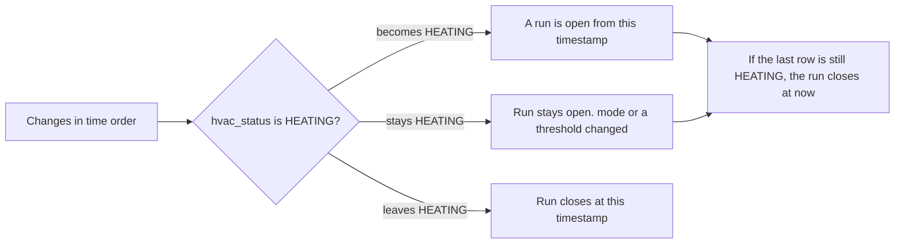

# Heating changes on the Monitor charts

This note is the whole contract for the Monitor page. It does not depend on any other design file.

## Goal

Read the heating change log and paint a red wash behind the temperature line for the times the heating is actually running. Keep the temperature line, the previous-period line, and the Daily / Weekly windows as they are.

The current page can keep reading `web_database.heating_samples`. That collection stays in place and keeps receiving a heartbeat on every Nest poll. Switch this page to `web_database.heating_changes` when this note is implemented. Until that switch, leave the current reader alone.

`heating_changes` is one row each time the thermostat changes. Until the next row, those values are still in force. The page does not see a sample every minute, and it must not invent one. There is no sample interval and no gap rule. A gap check would cut a real run short, because a steady `HEATING` at steady thresholds writes no further row.

| Field | Meaning |
| --- | --- |
| `hvac_status` | Whether the equipment is actively heating or cooling. The wash follows `HEATING` only |
| `mode` | Whether the equipment will call for heat or cool against its thresholds |
| `heat_celsius` | The heat threshold, in degrees Celsius |
| `cool_celsius` | The cool threshold, in degrees Celsius |

The chart paints `hvac_status == HEATING`. A row that only moves `mode`, `heat_celsius`, or `cool_celsius` does not start or stop the wash. `COOLING` is kept on the row and is not drawn. Mode and both thresholds are on the payload so a later usage page can read the setting that was in force.

There is one thermostat. Draw that one timeline on every room chart. When “Previous period” is on, the amber temperature line is the previous window and the wash stays on this period’s heating only.

## Stored documents

Database `web_database`, collection `heating_changes`. The unique index is `{ device_name: 1, timestamp: -1 }`.

```json
{
  "device_name": "Living Room Nest",
  "timestamp": { "$date": "2026-10-24T14:40:00.000Z" },
  "hvac_status": "COOLING",
  "mode": "HEATCOOL",
  "heat_celsius": 18.0,
  "cool_celsius": 23.0
}
```

| Field | Rule |
| --- | --- |
| `device_name` | Nest display name. This house has one thermostat |
| `timestamp` | UTC time when this combination was first observed |
| `hvac_status` | `OFF`, `HEATING`, or `COOLING` |
| `mode` | Nest mode, such as `HEAT`, `COOL`, `HEATCOOL`, or `OFF`. Omitted when that poll had none |
| `heat_celsius` | Heat threshold. Omitted when Nest did not send `heatCelsius` |
| `cool_celsius` | Cool threshold. Omitted when Nest did not send `coolCelsius` |

A `HEAT` poll carries `heat_celsius` and omits `cool_celsius`. A `COOL` poll carries `cool_celsius` and omits `heat_celsius`. `HEATCOOL` carries both. A missing threshold is not `0`.

Do not read `heating_samples` for this wash. Those rows are heartbeats, including repeats of an unchanged thermostat. This reader uses `heating_changes` only.

## Payload

`GET /tools/monitor/timeseries` gains a sibling of `data`. The handlers are mounted at `/tools/monitor/timeseries` and `/tools/monitor/latest_data`. The page script requests `/timeseries/` and `/latest_data/` every 5 seconds. A page that ignores unknown keys keeps drawing temperature.

```json
{
  "data": [
    {
      "device_id": "hall",
      "data": [{ "timestamp": "2026-10-24T17:05:00+00:00", "temp": 19.4, "humidity": 48.0 }]
    }
  ],
  "heating": {
    "device_name": "Living Room Nest",
    "device_id": "living-room-nest",
    "changes": [
      {
        "timestamp": "2026-10-24T12:00:00+00:00",
        "hvac_status": "HEATING",
        "mode": "HEAT",
        "heat_celsius": 20.0
      },
      {
        "timestamp": "2026-10-24T12:10:00+00:00",
        "hvac_status": "HEATING",
        "mode": "HEAT",
        "heat_celsius": 21.0
      },
      {
        "timestamp": "2026-10-24T12:20:00+00:00",
        "hvac_status": "OFF",
        "mode": "HEAT",
        "heat_celsius": 21.0
      },
      {
        "timestamp": "2026-10-24T14:30:00+00:00",
        "hvac_status": "COOLING",
        "mode": "HEATCOOL",
        "heat_celsius": 18.0,
        "cool_celsius": 24.0
      },
      {
        "timestamp": "2026-10-24T14:40:00+00:00",
        "hvac_status": "COOLING",
        "mode": "HEATCOOL",
        "heat_celsius": 18.0,
        "cool_celsius": 23.0
      },
      {
        "timestamp": "2026-10-24T14:45:00+00:00",
        "hvac_status": "OFF",
        "mode": "HEATCOOL",
        "heat_celsius": 18.0,
        "cool_celsius": 23.0
      }
    ]
  }
}
```

| Field | Meaning |
| --- | --- |
| `device_name` | `device_name` from the stored row |
| `device_id` | `device_name.lower().replace(" ", "-")`, the same slug as a temperature series |
| `changes[].timestamp` | ISO 8601 UTC |
| `changes[].hvac_status` | `OFF`, `HEATING`, or `COOLING` |
| `changes[].mode` | Omitted when the stored row has none |
| `changes[].heat_celsius` | Omitted when the stored row has none |
| `changes[].cool_celsius` | Omitted when the stored row has none |

`changes` includes every `heating_changes` row with `timestamp >= since`, plus the single newest row with `timestamp < since` when one exists. `since` is the expression the timeseries handler already uses for temperature, `datetime.now() - timedelta(days=14)`. That clock is naive and the stored timestamps are UTC. Keep the existing expression. The extra row is the reading already in force at the start of the 14 days. Without it, a run that began earlier has no start, and the chart cannot tell unknown from off.

```python
since = datetime.now() - timedelta(days=14)
changes = list(
    db.heating_changes.find({"timestamp": {"$gte": since}}).sort("timestamp", 1)
)
prior = db.heating_changes.find_one(
    {"timestamp": {"$lt": since}},
    sort=[("timestamp", -1)],
)
if prior is not None:
    changes.insert(0, prior)
```

If that query returns more than one `device_name`, omit `heating`. Mixing two thermostats on one timeline is out of scope. Omit `heating` when the collection has no rows. The temperature array is unchanged.

Sort `changes` by timestamp ascending before responding. Pass the four heating fields through. Do not replace a missing threshold with `0`.

## Windows

`getPeriodBounds(period, periodOffset)` is the window. Daily is the rolling 24 hours ending now. Weekly is the rolling 7 days ending now. Offset `1` is the equal span immediately before that. The windows are not calendar days and not midnight-aligned.

Temperature points inside a window are `timestamp >= start && timestamp < end`. Heating runs use that same clip.

## Turning changes into runs



1. Sort by timestamp.
2. `hvac_status == HEATING` opens a run when the previous in-force status was not `HEATING`.
3. A later row that is still `HEATING` leaves that run open. Its `mode`, `heat_celsius`, and `cool_celsius` are the setting from that timestamp onward. It does not start a second rectangle.
4. A later row whose `hvac_status` is anything else, including `OFF` and `COOLING`, closes the heating run at that timestamp. The `COOLING` row stays in `changes`.
5. If the last row is `HEATING`, the run stays open through now. If the last row is not `HEATING`, the run does not extend.
6. Clip to the window: start inclusive, end exclusive.

The morning rows are one heating run, 12:00–12:20. The 12:10 row changes the heat threshold from 20.0 to 21.0 and the wash continues. The afternoon rows stay in the payload: cooling runs from 14:30 to 14:45, and the 14:40 row only moves `cool_celsius`. That stretch is not a red wash. A window that opens at 12:10 still starts the wash at 12:10, because the 12:00 row is in the payload and the status in force at 12:10 is `HEATING`.

Extend an open run to now only while clipping a window that already ends at now. The previous window ends in the past. A run still `HEATING` at that end is clipped there.

Do not pass these rows through `smoothTemperatureSeries` or `alignPreviousPeriodData`. Smoothing would average a status. The previous-period shift would paint an older run on today’s clock. While drawing the wash, ignore `mode`, `heat_celsius`, and `cool_celsius`.

## How to draw it

Each room chart is one SVG, `chart-{device_id}` in `website/templates/tools/monitor/monitor.html`. `device_id` is `device_name.lower().replace(" ", "-")`. Humidity is a number beside the chart, not a line. The plot maps time across and degrees up, with 30px horizontal padding and 40px vertical padding. Y limits are `floor(min)` and `ceil(max)` of the current temperature line and the overlay line together.

The current temperature line is class `temperature temperature-current` (green `#0f8f7a`, dark `#2dceb2`). The previous-period line is class `temperature-overlay` (amber `#b56a12`, dark `#e0a24a`). The wash sits behind both lines.

In both `drawChart` and `updateChart`, after `drawGrid` and before `drawTemperature`:

1. Remove `#heating-bands-{device_id}` if it exists. `{device_id}` here is the room chart id.
2. If `heating` is missing or `changes` is empty, draw nothing.
3. Build runs with the rule above, clipped to `getPeriodBounds(chartPeriod, 0)`. Paint that one timeline on every room chart.
4. Append `<g class="heating-bands" id="heating-bands-{device_id}">` with one `<rect class="heating-band">` per clipped run. Map x through the same matrix as the polyline. Y spans the plot from `minTemp` to `maxTemp`. Clip to that rectangle so the wash does not cover the degree labels.
5. `pointer-events: none`. A `<title>Heating running</title>` on the group is the accessible name. Scrubbing keeps using polyline points.

Rebuild the group in both functions. A later grid append covers the wash, and a second update duplicates it, unless the old group is removed first.

```css
.chart-svg .heating-band {
  fill: var(--heating-band);
  stroke: none;
}
```

| Theme | Token | Value |
| --- | --- | --- |
| Light | `--heating-band` | `rgba(180, 35, 24, 0.23)` |
| Dark | `--heating-band` | `rgba(255, 122, 110, 0.31)` |

Set the token on `:root` and `body.dark-mode` in `website/static/css/tools/monitor/monitor.css`. Light danger in the site tokens is `#b42318` and dark danger is `#ff7a6e`. The wash uses those hues at the opacities in the table. The softer danger tint used by the Offline pill is too faint on the plot.

Leave the toolbar alone. Temperature is not optional, and the wash is not a third checkbox next to “Previous period” and “Smoothed”. “Smoothed” changes the temperature line only. A smoothed line can rise before a band or lag it, because the average is 45 minutes on Daily and 3 hours on Weekly. “Previous period” draws the amber temperature line and leaves the wash on this period’s runs.

Do not write “Heating” into `#status-{device_id}`. That node is online or offline.

Until `heating_changes` has rows, omit `heating`. The chart then matches a temperature-only page. Do not draw a band for unknown, and do not fall back to `heating_samples` inside this reader.

## Later usage totals

A usage page is not part of this change. When it is built, heating duration is the sum of the same clipped `HEATING` runs, not a count of rows and not a measurement of the rectangles. `mode`, `heat_celsius`, and `cool_celsius` on each row are the call setting and the thresholds from that timestamp until the next row. `COOLING` rows are available for a later cooling total. They are not added to the heating duration.

- Current window: sum of runs clipped to `getPeriodBounds(period, 0)`, with a trailing `HEATING` extended to now.
- Previous window: the same function at offset `1`. A trailing `HEATING` stops at that window’s end.

A range wider than 14 days needs its own query against `heating_changes`. Use the same “rows from `since`, plus the one row before `since`” read. The chart payload is the shared read for the horizons the charts already have.

## Where to edit

| File | Edit |
| --- | --- |
| `website/tools/monitor/models.py` | Optional `heating` on the timeseries response: `device_name`, `device_id`, and `changes` of `timestamp`, `hvac_status`, `mode`, `heat_celsius`, and `cool_celsius` |
| `website/tools/monitor/router.py` | Load `web_database.heating_changes` with the 14-day `since` above, including the one prior row |
| `website/static/js/tools/monitor/monitor.js` | Build `HEATING` runs from `heating.changes` and append the band group in `drawChart` and `updateChart` |
| `website/static/css/tools/monitor/monitor.css` | `--heating-band` and `.heating-band` |

The service worker already fetches `/timeseries/` from the network. The new object rides that response. The page script has to be updated before this wash appears. The existing heartbeat reader, if the page already has one, is the code this change replaces.

## Decisions

1. **Read `web_database.heating_changes`.** Leave `heating_samples` to the current page until this reader replaces it.
2. **`heating.changes` is the series.** Each item carries `timestamp`, `hvac_status`, `mode`, `heat_celsius`, and `cool_celsius`. There is no sample interval.
3. **Include the newest row before the 14-day horizon** so a reading already in force has a start.
4. **A wash runs from a transition into `HEATING` until a transition out of it.** A later row that is still `HEATING` only updates `mode` or a threshold. `COOLING` stays on the row and is not drawn. The last `HEATING` extends to now on the current window only.
5. **Draw this period’s runs on every room chart.** Previous-period heating stays in the payload and is not drawn.
6. **Omit `heating` when there is no row, or more than one `device_name`.** The chart then matches a temperature-only page.
